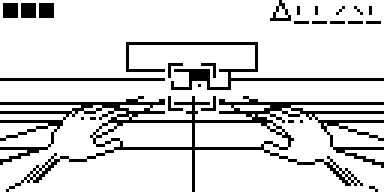

# Cyber Escape

A rail flight through cyberspace for the Arduboy / Arduboy FX, inspired by the 3D levels of
*The Lawnmower Man* (Sega Genesis).

**Play in the browser:** https://tiberiusbrown.github.io/Ardens/player.html?file=https://raw.githubusercontent.com/andreyfahrenheit/CyberEscape/refs/heads/main/CyberEscape.hex

## Controls

| Button | Action |
| --- | --- |
| D-Pad | Move |
| A | Start / next level / pause |
| B | Restart level |
| A + B | Restart game |

## Build

Arduino IDE with the Arduboy2 library (6.0+). Open `CyberEscape.ino`, select the Arduboy board and upload.
A prebuilt binary is in `CyberEscape.hex`; `CyberEscape.arduboy` is the packaged version for game catalogs
and FX flashcart tools.

## Notes

18 procedurally generated levels, alternating day and night, three speed phases, ten keys per level,
three lives, an exit cube on the final level. Integer math only, no dynamic allocation, 60 FPS on an
ATmega32u4 — 25 KB flash, ~1.4 KB RAM.

MIT-licensed unless stated otherwise. SKRTM, 2026.
