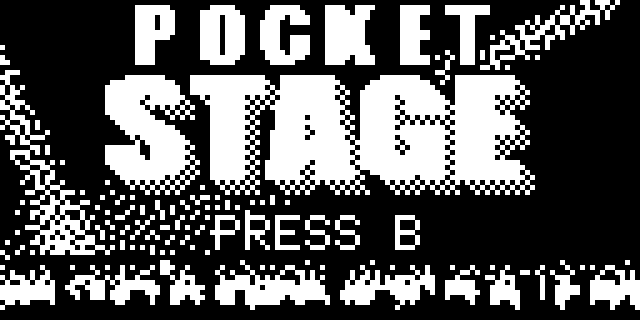

# Pocket Stage



A Guitar Hero like game for the **Arduboy FX**: fifteen songs written for the
game, four difficulties, and the band on the stage behind the notes.

<!-- I recorded some gameplay on my Arduboy FX: [video on YouTube](https://www.youtube.com/watch?v=...) -->

## Play

Download [PocketStage.arduboy](download/PocketStage.arduboy).

- It should work on both the FX and the FX-C (the game finds out which one it
  runs on when it starts); I have only tried the FX-C in an emulator.
- In the browser: drop the file on the
  [Ardens player](https://tiberiusbrown.github.io/Ardens/player.html).

## Controls

| Button | In a song | In the menus |
|---|---|---|
| Left, Up or Down, Right | The three lanes (hold for long notes) | Up, Down: move |
| A (lower) | Star power, once the meter is half full | Back |
| B (upper) | Pause | Pick |

On the setlist, Left and Right change the difficulty.

## Build

```bash
tools/build.sh
```

What it needs: [docs/build.md](docs/build.md).
Everything else: [docs/notes.md](docs/notes.md).
